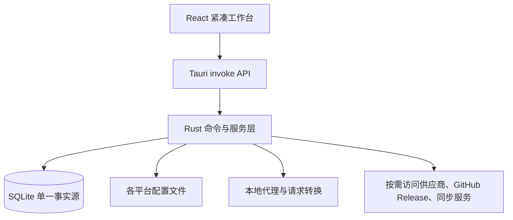

# 重置版架构说明

## 目标

以低启动成本、低资源占用和真实功能为优先，在不改动原项目的前提下，将成熟的多平台配置管理能力重组为 Hermes Provider Switcher。

## 架构

## 关键决策

### ADR-001：Tauri 原生壳替代 Electron

- 原因：减少 Chromium 常驻开销、缩短启动路径、让平台检测和文件操作在原生层完成。
- 代价：Windows 发布机需要 Rust、MSVC linker 和 Windows SDK。
- 兼容：React 组件和现有 API 层继续使用，功能迁移不依赖静态演示。

### ADR-002：更新检查与安装解耦

- 检查只请求公开 Release 元数据，连接与总请求均有 8 秒上限。
- 不在启动阶段调用网络。
- 没有 Hermes 自有签名密钥前，发现新版本只打开 Hermes Release 页面，不启动参考项目的自动安装器。

### ADR-003：新旧数据目录隔离

- 重置版默认使用 `~/.hermes-provider-switcher-reset/`。
- 原项目数据保持原位；用户可通过设置中的目录覆盖显式选择其他目录。
- 技能、备份、日志和数据库均从应用配置目录派生，避免部分模块仍写入旧目录。

### ADR-004：按需加载与渐进展示

- 首页不做全平台探测。
- 设置页工具版本采用模块缓存、十分钟 TTL 和逐工具并发返回。
- MCP、Skills、Prompts 等大型面板按工作区进入后加载。
